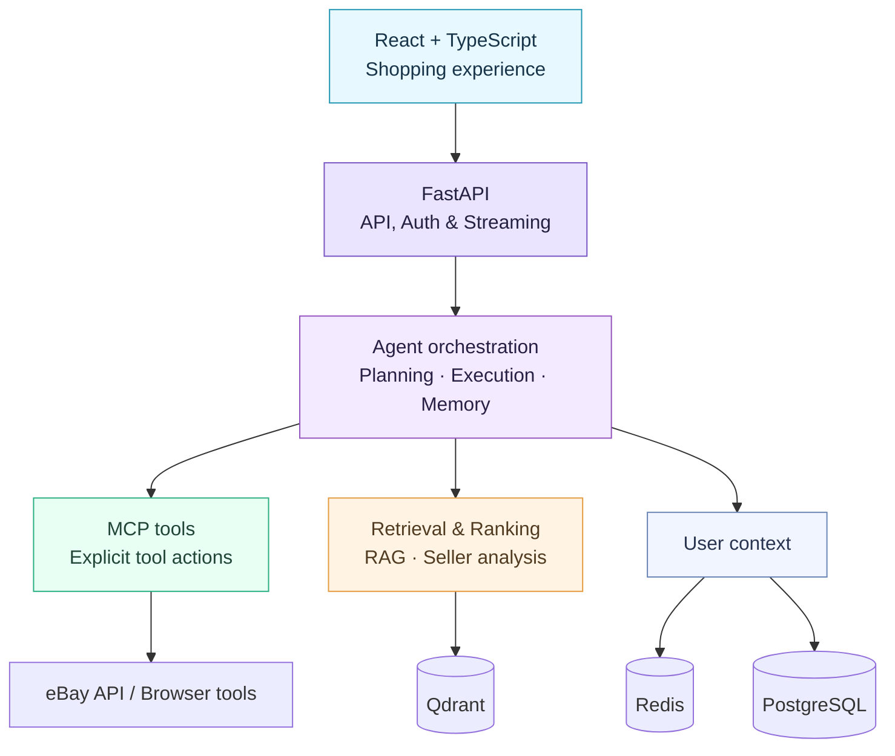

<div align="center">

# 🛍️ MCP E-Commerce

### AI Shopping Assistant · Model Context Protocol · Agentic Workflows

**From natural-language shopping requests to explicit tools, retrieval and a real web application.**


</div>

> **Portfolio project:** A full-stack AI-assisted shopping platform built around eBay, dedicated MCP tools, an agent orchestration layer, semantic retrieval and a React interface. Some functions require external credentials and running infrastructure.

## ✨ At a glance

| 🧠 AI workflows | 🔎 Product discovery | 🧰 Software engineering |
| --- | --- | --- |
| Agent planning, explicit MCP tools, conversational memory | eBay search, semantic retrieval, seller/trust analysis, price tracking | FastAPI, PostgreSQL, Redis, Qdrant, React, TypeScript |

### What can a user do?

- Search for products through natural-language requests and structured tool calls.
- Retrieve item details and inspect seller-related information.
- Explore deals, comparisons and product recommendations.
- Manage profiles, preferences and wishlists.
- Follow conversations with streamed responses in the React UI.
- Use browser-assisted actions when supported and properly configured.

## 🧩 Architecture



The MCP server is mounted in the FastAPI application. Agent planning, execution, tool registration, memory and prompts are organized as separate components. The diagram shows architectural responsibilities, not a promise that every service can run without configuration.

**Explore the implementation:** [Agent](app/agent/) · [MCP](app/mcp/) · [Services](app/services/) · [Frontend](ebay-ui/) · [Technical diagrams](docs/)

## 🛠️ Stack

| Layer | Technologies |
| --- | --- |
| Backend | Python, FastAPI, SQLAlchemy, Alembic |
| AI and tools | MCP, LLM services, Sentence Transformers, RAG, Playwright |
| Storage and retrieval | PostgreSQL, Redis, Qdrant |
| Frontend | React 19, TypeScript, Vite, Material UI, Ant Design |
| Infrastructure | Docker Compose, HTTP integrations, SSE streaming |

## 🚀 Run locally

### Requirements

- Python environment compatible with the versions in [`requirements.txt`](requirements.txt) (Python 3.11 is a reasonable starting point; verify dependency compatibility on your OS).
- Node.js and npm for the React frontend.
- Docker Desktop or Docker Engine with Compose.
- External API credentials for eBay/LLM features you intend to use.

### 1. Configure and launch infrastructure

```bash
cp .env.example .env
# Edit .env; set real local passwords and required service keys
docker compose up -d
```

Compose starts PostgreSQL (**localhost:5435**), Redis (**localhost:6379**) and Qdrant (**localhost:6333**). It reads the `.env` file automatically from the project directory.

### 2. Install and start FastAPI

```bash
python -m venv .venv
# Linux/macOS: source .venv/bin/activate
# Windows PowerShell: .\.venv\Scripts\Activate.ps1
python -m pip install -r requirements.txt
python -m uvicorn app.main:app --reload --port 8050
```

On Windows, [`start_dev.ps1`](start_dev.ps1) provides an alternative Docker-and-backend workflow after creating the environment. FastAPI serves on **http://127.0.0.1:8050**.

> The backend performs model loading and service initialization at startup, so availability and startup time depend on the configured integrations. This is not a credential-free, one-command demo.

### 3. Start React

In a second terminal:

```bash
cd ebay-ui
npm ci
npm run dev
```

Open the URL printed by Vite (typically **http://localhost:5173**).

Stop the infrastructure when done: `docker compose down`. Don't use `docker compose down -v` unless you intend to delete database volumes.

## ✅ Quality checks

The repository includes test modules under [`tests/`](tests/) for agent, API and MCP behavior. Running the complete suite requires the appropriate environment and integrations:

```bash
python -m pip install pytest
python -m pytest tests -q
```

The [GitHub Actions workflow](.github/workflows/portfolio-ci.yml) performs **Python syntax compilation** and a **React production build**. These are smoke checks, not proof of end-to-end correctness or external API integration.

## 🔐 Configuration and boundaries

- Use [`.env.example`](.env.example) as a template; never commit personal secrets or real tokens.
- eBay, LLM and browser features require additional external configuration.
- Seller trust signals are application heuristics; they should not be interpreted as verified guarantees about sellers.
- Documentation describes the system's design; production readiness, security and correctness require independent validation.

## 👨‍💻 Author

[**Paolo Pangallo**](https://github.com/PaoloPangallo) · M.Sc. candidate in Computer Engineering — Artificial Intelligence · [LinkedIn](https://www.linkedin.com/in/paolo-pangallo-9aa456170/)
